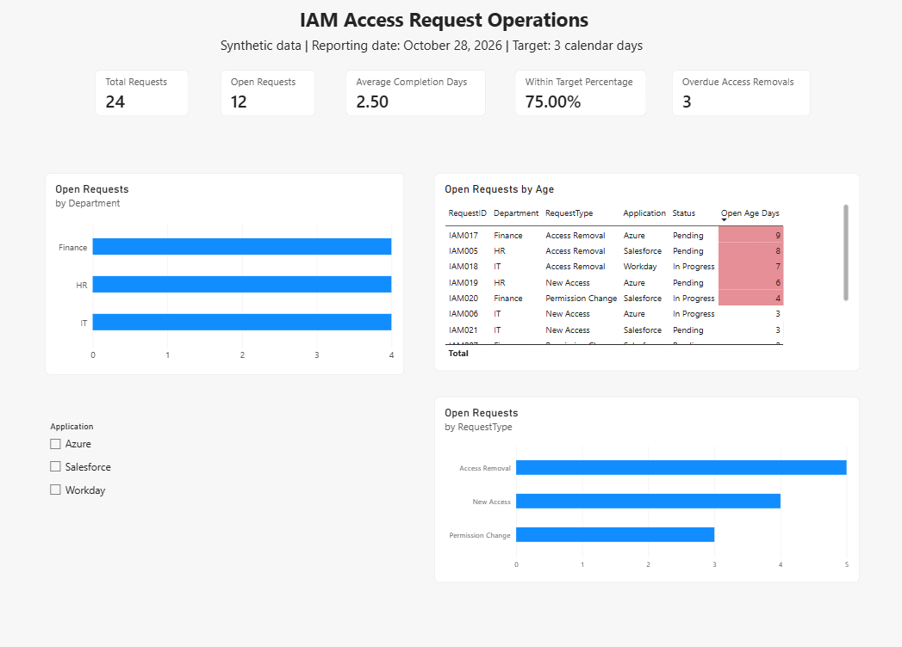
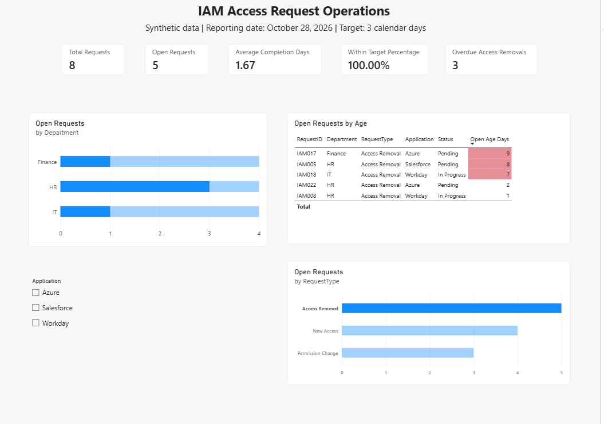
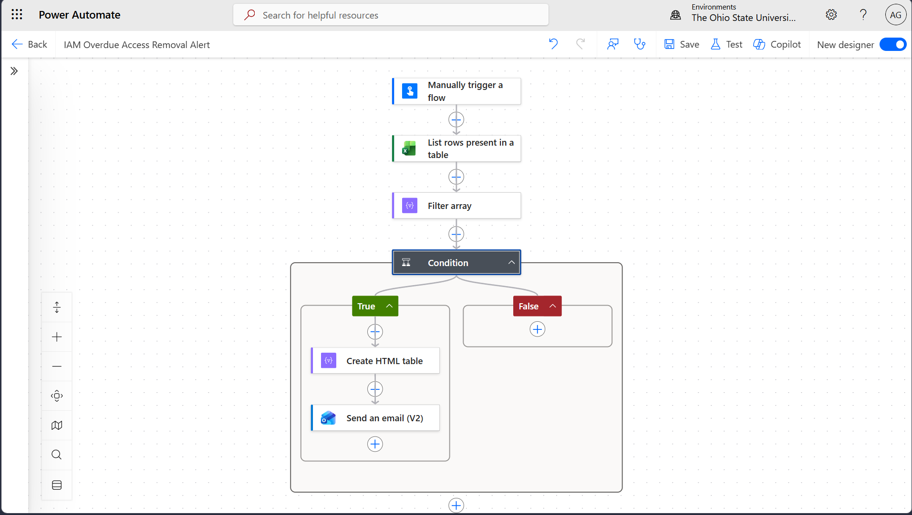
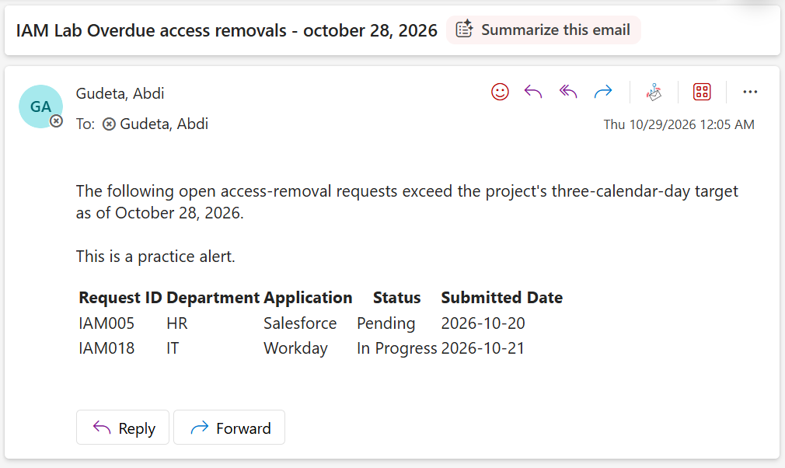

# IAM Operations Reporting and Alert Automation

A personal learning project using Power BI and Power Automate to monitor access-request workload, completion performance, and delayed access removals.

Built using 24 synthetic requests across Finance, HR, and IT. No real employee or company records are included.

## Dashboard



## Business Questions

- How many access requests are still open?
- Which departments and request types account for the backlog?
- How long do completed requests take?
- What percentage of completed requests meet the target?
- Which access removals need follow-up?

## Tools

- Power BI Desktop for report visuals and filtering
- Power Query for data preparation
- DAX for measures and calculated columns
- Excel for the sample request data
- Power Automate for conditional email alerts
- OneDrive for Business for the original shared workbook

## Report Features

- Cards showing request volume, completion performance, and overdue removals
- Open requests grouped by department and request type
- Application slicer for filtering
- Request detail table sorted by age
- Conditional formatting highlighting open requests older than the target
- Definitions page documenting metrics, assumptions, and validation

## Metrics

Reporting date: **October 28, 2026**  
Project target: **3 calendar days**

| Metric | Definition | Baseline |
|---|---|---:|
| Total Requests | Number of request rows | 24 |
| Open Requests | Pending or In Progress requests | 12 |
| Average Completion Days | Average nonblank duration between submission and completion | 2.50 |
| Within Target Percentage | Completed requests finished within 3 days divided by all completed requests | 75% |
| Overdue Access Removals | Open Access Removal requests older than 3 days | 3 |

## Investigating Access Removals

Selecting Access Removal narrows the report to removal requests. The detail table identifies the oldest open requests for follow-up.



The baseline overdue removals are IAM017, IAM005, and IAM018, aged 9, 8, and 7 calendar days respectively.

## Data Preparation

The initial practice data included an inconsistent status label and an exact duplicate.

Power Query transformations:
- Standardized `complete` to `Completed`
- Assigned appropriate column data types
- Removed one exact duplicate across all columns

The final dataset contains 24 requests. Each row represents one request.

Columns:
- RequestID
- Department
- RequestType
- Application
- SubmittedDate
- CompletedDate
- Status

## Email Alert Flow

The manually triggered Power Automate flow:
1. Reads the Excel table from OneDrive for Business.
2. Filters for Pending or In Progress access removals older than 3 days.
3. Checks whether any matching records exist.
4. Creates an HTML table and emails a summary when matches exist.
5. Skips the email when no records match.



### Example Alert



## Validation

- Confirmed all five baseline report metrics.
- Confirmed the alert contained IAM005, IAM017, and IAM018.
- Tested an empty result and confirmed the email was skipped.
- Marked IAM017 as Completed in the shared workbook and confirmed the report's overdue count decreased from 3 to 2.
- Confirmed the email excluded IAM017 after the change.
- Restored the original record and baseline results.
- Refreshed the public report copy using the local workbook and confirmed the baseline metrics.

See [validation details](docs/validation.md).

## Opening the Power BI Report

1. Download this repository and extract it if downloaded as a ZIP.
2. Open `powerbi/IAM_Operations_Public.pbix` in Power BI Desktop.
3. Select **Home > Transform data**.
4. Select the supporting query named `IAMRequests`, without an underscore.
5. Select its **Source** step.
6. Update the file path to your downloaded sample workbook:

```powerquery
= Excel.Workbook(File.Contents("C:\your-folder\data\IAM_Access_Requests.xlsx"), null, true)
```

7. Select **Close & Apply**, then refresh.
8. Clear report selections and compare the cards with the baseline metrics above.

Keep the workbook's Excel table name as `IAMRequests`.

## Recreating the Automation

The original working report and flow read the same Excel workbook in OneDrive for Business.

The public Power BI copy reads the included local workbook. To recreate the automation, upload the sample workbook to your own OneDrive for Business and configure your own Excel and Outlook connections.

See [Power Automate setup and expressions](docs/power-automate.md).

## Documentation

- [DAX measures and calculated columns](docs/measures.md)
- [Power Automate configuration](docs/power-automate.md)
- [Validation results](docs/validation.md)
- [Report definitions screenshot](screenshots/03-definitions.png)

## Assumptions and Limitations

- All request records are synthetic.
- The 3-day target is a project assumption.
- Durations include weekends and holidays.
- The reporting date is fixed for reproducible results.
- Power BI requires a refresh to read workbook changes.
- The flow is manually triggered and can send another summary on each run.
- Request records do not establish why work is delayed or whether access remains active.
- The flow reports overdue requests; it does not revoke access.

## What I Practiced

- Translating operational questions into reporting metrics
- Preparing and checking data with Power Query
- Writing DAX measures and calculated columns
- Building interactive report visuals
- Filtering connector output in Power Automate
- Creating conditional HTML email summaries
- Checking consistency between a report and an alert
- Documenting assumptions, setup steps, and test results